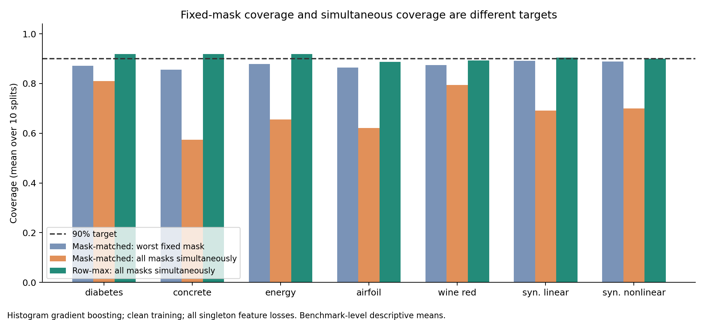
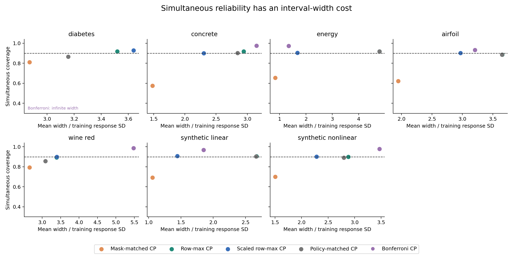
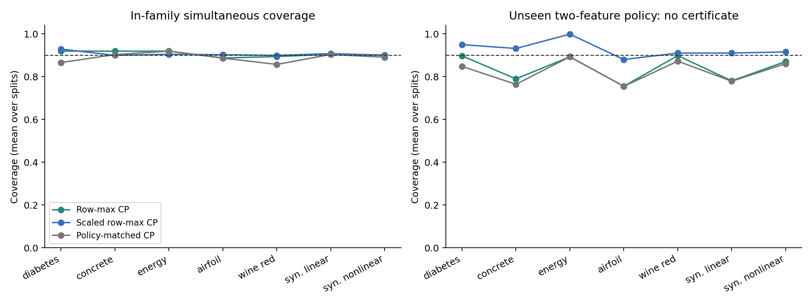

# Experiment results — research notes, not a paper

Completed 280 predictor fits and 90,720 metric cells across 7 datasets, 10 prespecified splits, two model families, two training arms, three mask families, and two error levels.

These are measured local results. Primary tables below use histogram gradient boosting with clean training, all single-feature losses plus the clean mask, and 90% target coverage. The complete factorial results are in summary.csv. No model or seed was selected using test performance.

## Primary endpoint comparison

Each entry averages the ten splits within a dataset. 'Worst fixed' is the smallest coverage among counterfactual fixed masks; 'simultaneous' requires every mask to cover the same row. Widths are divided by the training response standard deviation.

| Dataset | Mask-matched worst fixed | Mask-matched simultaneous | Row-max simultaneous | Scaled row-max simultaneous | Row-max width | Scaled width |
| --- | ---: | ---: | ---: | ---: | ---: | ---: |
| diabetes | 87.2% | 81.0% | 91.9% | 92.8% | 3.519 | 3.638 |
| concrete | 85.5% | 57.5% | 91.9% | 89.9% | 2.941 | 2.301 |
| energy | 87.8% | 65.5% | 91.9% | 90.4% | 4.787 | 1.677 |
| airfoil | 86.5% | 62.1% | 88.7% | 90.2% | 3.656 | 2.969 |
| wine_red | 87.5% | 79.4% | 89.4% | 89.9% | 3.389 | 3.394 |
| synthetic_linear | 89.2% | 69.1% | 90.4% | 90.7% | 2.670 | 1.444 |
| synthetic_nonlinear | 88.9% | 70.0% | 90.0% | 90.0% | 2.883 | 2.282 |

Across these seven primary cells, the descriptive mean fixed-versus-simultaneous gap for mask-matched CP is 18.3 percentage points. Row-max simultaneous coverage averages 90.6%; scaled row-max averages 90.6%. These equal-weight cross-dataset averages are descriptive, not population estimates or statistical significance claims.

The reported worst-fixed value is a minimum over finite empirical mask coverages. Selecting that minimum introduces downward selection bias, so a value below 90% is not by itself evidence against the per-fixed-mask theorem. Simultaneous coverage measures a different event.

## Efficiency and paired uncertainty

Positive saving means scaled row-max is narrower than unscaled row-max. Intervals resample the ten paired split seeds; they describe split stability conditional on these fixed datasets. Repeated splits overlap, so this is not an independent-population confidence statement.

| Dataset | Relative width saving | Paired split-bootstrap 95% interval | Simultaneous coverage change |
| --- | ---: | ---: | ---: |
| diabetes | -3.5% | [-7.2%, -0.2%] | +0.9 pp |
| concrete | 21.8% | [18.8%, 24.5%] | -1.9 pp |
| energy | 64.9% | [62.2%, 67.6%] | -1.5 pp |
| airfoil | 18.7% | [16.5%, 21.3%] | +1.5 pp |
| wine_red | -0.1% | [-1.6%, 1.2%] | +0.5 pp |
| synthetic_linear | 45.9% | [44.8%, 46.9%] | +0.3 pp |
| synthetic_nonlinear | 20.9% | [19.9%, 21.8%] | +0.0 pp |

Scaling improves mean width in 5/7 primary dataset cells. Its benefit is empirical and not universal; all losses remain reported.

## Model and training ablations

Each row averages datasets equally, after averaging the ten splits in each dataset. These are descriptive summaries; raw paired cells and uncertainty are in the CSV files.

| Predictor | Training | Mask-matched simultaneous | Row-max simultaneous | Scaled simultaneous | Row-max width | Scaled width |
| --- | --- | ---: | ---: | ---: | ---: | ---: |
| ridge | clean | 76.0% | 90.6% | 90.2% | 3.374 | 2.871 |
| ridge | mask_augmented | 78.1% | 90.5% | 90.3% | 3.056 | 2.694 |
| histgb | clean | 69.2% | 90.6% | 90.6% | 3.407 | 2.529 |
| histgb | mask_augmented | 70.3% | 90.3% | 90.2% | 2.708 | 2.291 |

Mask augmentation lowers robust interval width in these descriptive aggregates; it does not remove the difference between fixed-mask and simultaneous coverage.

## Policy transfer and failure boundaries

| Dataset | Policy-matched: matching shift policy | Policy-matched: saturation | Policy-matched: simultaneous | Row-max: unseen pair policy |
| --- | ---: | ---: | ---: | ---: |
| diabetes | 92.4% | 93.9% | 86.6% | 89.7% |
| concrete | 90.8% | 97.1% | 90.3% | 78.9% |
| energy | 91.9% | 100.0% | 91.9% | 89.2% |
| airfoil | 88.7% | 94.8% | 88.6% | 75.5% |
| wine_red | 90.5% | 92.2% | 85.7% | 89.8% |
| synthetic_linear | 90.6% | 93.5% | 90.3% | 78.0% |
| synthetic_nonlinear | 89.8% | 92.3% | 89.0% | 87.0% |

The pair extension is explicitly heuristic: singleton certificates do not certify pair deletion. The oracle uses outcomes only as an exhaustive stress-test endpoint. Prediction-shift and saturation selectors use full input values at the loss-generation stage; they are not detectors after the values disappear.

## What this supports

An initial reproducible research project showing why fixed-mask, selected-policy, and simultaneous coverage require separate evaluation. The implementation applies established max-score conformal theory and evaluates an independent mask-scale ablation. It does not establish a novel algorithm or state-of-the-art performance. The modern weighted/ARC missingness methods and robust verification algorithms in literature.md have not been reproduced. Real failures and dataset-level shift are not measured.

A publishable manuscript would require expert novelty review, stronger related-method reproductions, and a richer task setting. A sensible extension is dependent sensor-group deletion with a user-specified budget and a real telemetry task, then a learned input-dependent positive scale trained on an independent split. The frozen results here should remain as the initial benchmark; extensions need a new protocol and results directory.

## Provenance and verification

Run elapsed time: 57.2 seconds. Machine/platform and complete pinned environment are recorded in manifest.json. Original archives, dataset hashes, duplicate removal, source hashes, raw predictions, split IDs, per-mask metrics, and runtime are saved. The test suite checks order-statistic calibration, infinity handling, split disjointness, frozen preprocessing, oracle equivalence, the exact counterexample, and a Monte Carlo rank check. validation.json records whole-run result consistency checks.

Artifact paths: results/full/metrics.csv, summary.csv, paired_comparisons.csv, per_mask.csv, runtime.csv, manifest.json, validation.json, and predictions/*.npz.
